---

## 👨‍💻 About Me

- 💼 Portfolio: [your-portfolio-link.com](https://your-portfolio-link.com)
- 🔭 Currently building: web & mobile apps
- 🌱 Learning: Next.js · Flutter · LLM apps
- 📫 Reach me at: [jonahgebeyhu@gmail.com](mailto:jonahgebeyhu@gmail.com)

---

## 🌐 Connect with Me

  
  
  

---

## 🛠 Tech Stack

  

---

## 💬 Random Dev Quote

  

---

## 📊 GitHub Stats

  
  
  

---

  
  ⭐️ If you like this profile, give it a star · Made with 💚 by builtbyHermes

